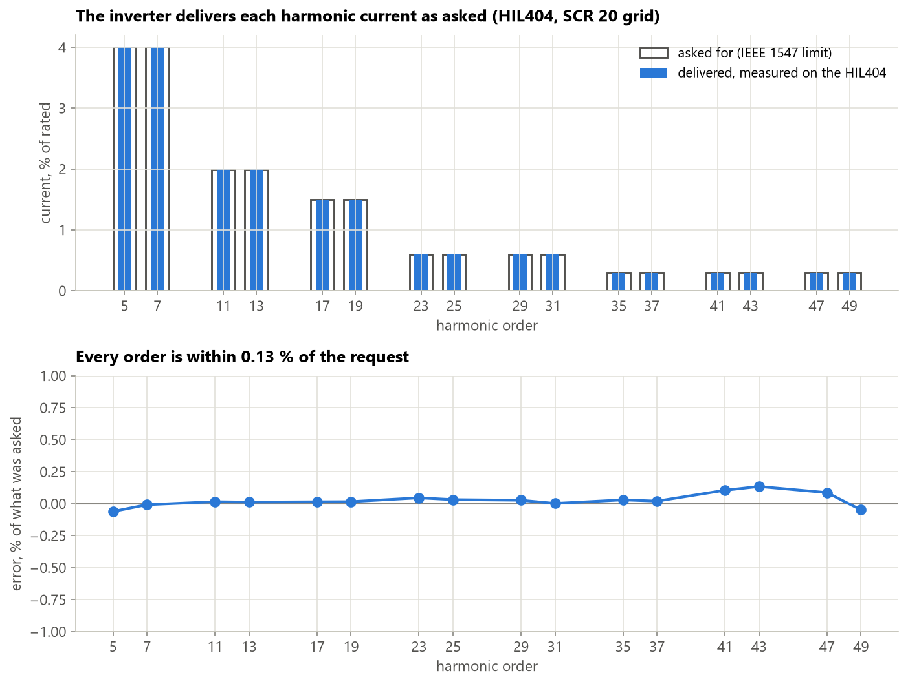

# A reference harmonic emitter on Typhoon HIL

Harmonic hosting-capacity studies usually model a PV inverter as an **ideal harmonic current source**.
A real inverter is a switching bridge with an LCL filter and a controller, and it can only behave like
that source within limits.

This repository is an **open reference emitter**: one 100 kVA PV inverter on Typhoon HIL that injects
each harmonic order at a level you choose, up to the IEEE 1547 limit. It was run in Virtual HIL and on a
real **HIL404** at Pulchowk Campus, Institute of Engineering, Tribhuvan University (5 Oct 2026). The notebooks show how well it delivers what it is
asked, whether it really acts as an ideal current source, and the three conditions it needs to do so.

*HIL404, SCR 20 grid, every order at its IEEE 1547 limit. Grey outline: asked for. Blue: delivered.
Bottom: the difference, within 0.13 % of the request.*

## Datasheet

Each number has a claim ID; the full list with sources is in [CLAIMS.md](CLAIMS.md).

| Item | Value | Claim |
|---|---|---|
| Rating | 100 kVA, 400 V, 50 Hz, DC 750 V (panel range 650-1000 V) | |
| Switching and control | 10 kHz; controller runs every 100 µs; LCL filter, resonance 1472 Hz on a stiff grid | C1.1 |
| Regulated orders | 5, 7, 11, 13, 17, 19, 23, 25, 29, 31, 35, 37, 41, 43, 47, 49 | |
| What you set (SCADA panel) | each order 0-100 % of its IEEE 1547 limit, a master scale, grid strength (stiff / SCR 20 / 10 / 5), DC voltage, grid frequency, background 5th/7th | |
| Accuracy, HIL404, settled | worst order 0.46 / 0.13 / 0.20 / 0.26 % of the request on stiff / SCR 20 / SCR 10 / SCR 5 (1000 V) | C2.1 |
| Real device vs Virtual HIL | largest THD_V difference over 82 operating points: 0.24 percentage points | C2.4 |
| Ideal current source? | at the regulated orders, yes: PCC voltage / current = grid impedance within 0.4 % | C3.1 |
| Leakage to other orders | at most 0.0025 % of rated at regulated orders not asked for | C3.2 |
| **Condition 1: stability** | needs active damping; a stiff-grid tuning is unstable on any real grid | C4.1, C4.2 |
| **Condition 2: frequency** | needs frequency-adaptive resonators (0.17 % over 49-51 Hz); fixed ones lose 89-97 % of the worst order 0.25 Hz off 50 Hz | C5.1, C5.2 |
| **Condition 3: DC voltage** | full emission at SCR 5 needs more than about 710 V; settling can take up to 2 min after a step | C6.1-C6.3 |
| Effect on voltage limits | full emission meets EN 50160 at SCR 20; SCR 10 allows 0.55 of it, SCR 5 0.28 | C7.1 |

## Notebooks

They run from the saved results; **no Typhoon software is needed to read or rerun them.**

| # | Notebook | Question |
|---|---|---|
| 00 | [Overview](notebooks/00_overview.ipynb) | What is this, in one figure and one table? |
| 01 | [The emitter](notebooks/01_the_emitter.ipynb) | Ratings, filter, request, grids, controller |
| 02 | [Does it deliver?](notebooks/02_does_it_deliver.ipynb) | Every order, every grid, HIL404 and Virtual HIL |
| 03 | [Ideal current source?](notebooks/03_ideal_current_source.ipynb) | V/I = grid impedance; other frequencies; background distortion |
| 04 | [Stability](notebooks/04_stability.ipynb) | Condition 1: why it needs active damping |
| 05 | [Grid frequency](notebooks/05_grid_frequency.ipynb) | Condition 2: why it needs adaptive resonators |
| 06 | [DC voltage and settling](notebooks/06_dc_voltage_and_settling.ipynb) | Condition 3: how much DC voltage, and how long to wait |
| 07 | [Voltage limits](notebooks/07_voltage_limits.ipynb) | What the emission does to EN 50160 / IEEE 519 |

Every figure is also saved in `notebooks/figures/` as a PNG with the numbers behind it in a CSV.

## What this does not show

- One inverter on a simple R-L grid, with X/R = 3 **assumed**. No cable capacitance, so no network resonance.
- Only the 16 orders above are regulated. Other frequencies are checked (notebook 03), not controlled.
- Voltage limits are compared with single 10-cycle snapshots, not the week-long statistics of EN 50160.
- Stability margins (notebook 04) come from a linear model; the HIL runs show it ran stably, not the margins.
- After a grid or DC step the controller can need minutes to settle near its voltage limit (no anti-windup yet).

## Use it

| To | Do |
|---|---|
| Read the results | open the notebooks (GitHub renders them) |
| Rerun the analysis | `pip install numpy pandas scipy matplotlib jupyter`, then run the notebooks |
| Run the emitter | Typhoon HIL Control Center 2026.3 (Virtual HIL is enough): see [hil_bench/README.md](hil_bench/README.md) |
| Put it in your own network | the emitter is one inverter block in `hil_bench/model/emission_bench.tse`; replace the R-L grid with your network |

## Folder layout

| Folder | Contents |
|---|---|
| `notebooks/` | The eight notebooks and their figures |
| `hil_bench/` | Model builder, C controller generator, run and sweep scripts, `analysis.py` (shared by the notebooks) |
| `hil_bench/model/` | Typhoon model (`.tse`), SCADA panel (`.cus`), C sources |
| `hil_bench/results/` | Raw results: Virtual HIL (`*_vhil*`), HIL404 (`*_hil404*`), CSV, PNG and run logs |

## Related work

- The CIGRE European MV benchmark feeder in PSCAD, the network this emitter is meant to be connected to:
  P. Bhattarai, R. Maharjan, "Open-source PSCAD/EMTDC implementation and validation of the CIGRE European
  MV benchmark network," accepted for PESIM 2027, Beijing. Preprint doi:10.13140/RG.2.2.16467.95521;
  code doi:10.5281/zenodo.22663701.

## Cite

P. Bhattarai, "A reference harmonic emitter on Typhoon HIL," 2026. A manuscript is in preparation.

## Acknowledgement

The HIL404 tests were run in the laboratory of the Department of Electrical Engineering, Pulchowk
Campus, Institute of Engineering, Tribhuvan University, Nepal. Parts of the code and text were drafted with the help of an AI
assistant (Claude, Anthropic) and checked by the author against the data.

## Licence

BSD 3-Clause, see [LICENSE](LICENSE). Running the model needs Typhoon HIL software, which has its own licence.
